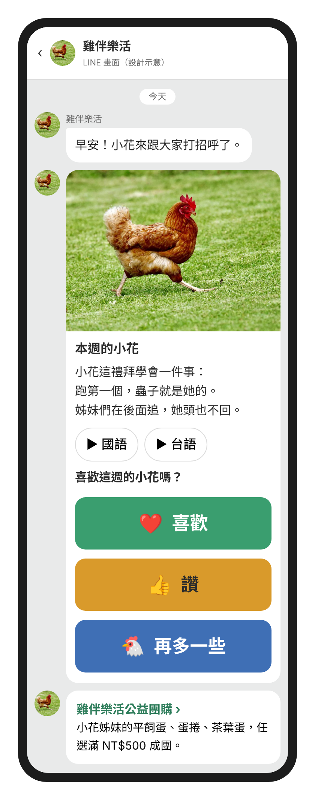
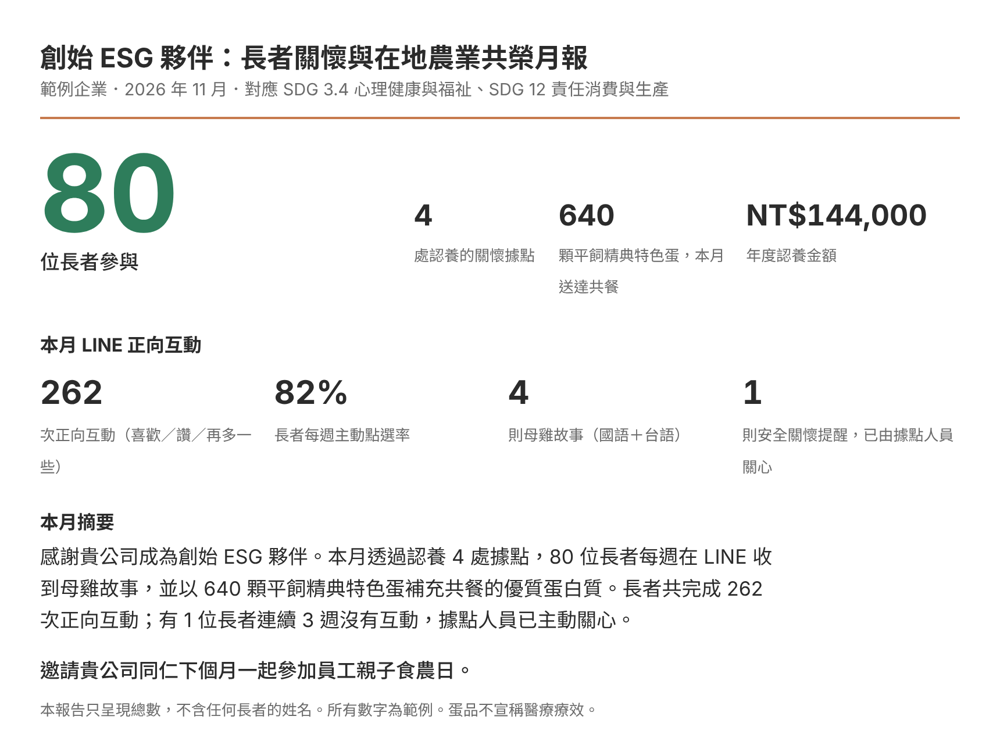

# 雞伴樂活 Adopt-a-Hen Care: MVP design mock-up

Clickable design mock-up for a team proposal in Taiwan's 9th Social Enterprise Startup Proposal Competition (November 2026).

**Live demo:** `https://manjeetkaurlavieenrose-cpu.github.io/hen-care-mvp/`

## The idea

Older adults at community care stations "adopt" hens kept on a partner farm. Each week they receive a short hen story in LINE and reply with one tap. Egg products are sold through LINE group buying, and sponsoring companies get a monthly ESG report.

## What is in the mock-up

| Screen | What it shows |
|---|---|
| Hen weekly card | Weekly story with three large positive buttons (喜歡／讚／再多一些) |
| Group-buy card | Three products, quantity steppers, group threshold |
| ESG monthly report | One-page sponsor report |
| LINE rich menu | Six-tile menu visual, 2500 × 1686 |

The page switches between Chinese and English.

## Honest notes

- This is a design mock-up, not a working product. Nothing is connected to LINE.
- All figures are sample data for illustration.
- The phone frame follows LINE's chat conventions so the screens feel familiar to older users. It is not affiliated with LINE.

## Credits

- Concept and business plan: Dr Chung-Ming Chang and Team 1
- UI and visual design of this mock-up: Manjeet Kaur
- Product photos: provided by the team
- Hen photo: Unsplash

## Run it

Open `index.html` in any browser. It is one self-contained file with no build step.
